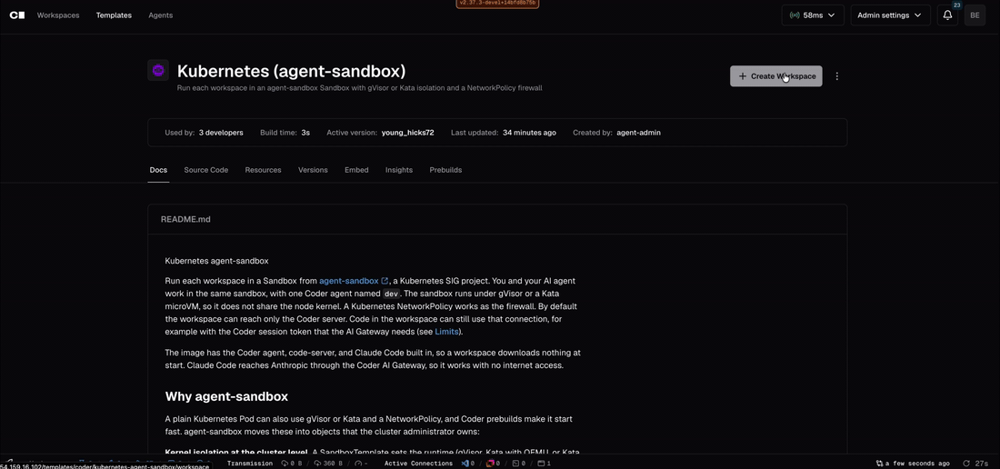

# agent-sandbox (Kubernetes)

Run each workspace in a Sandbox from [agent-sandbox](https://github.com/kubernetes-sigs/agent-sandbox), a Kubernetes SIG project. You and your AI agent work in the same sandbox, with one Coder agent named `dev`. The sandbox runs under gVisor or a Kata microVM, so it does not share the node kernel. A Kubernetes NetworkPolicy works as the firewall, and ClusterNetworkPolicy or [Cilium](https://cilium.io/) can add more advanced rules (see [Firewall](#firewall)). By default the workspace can reach only the Coder server.

## Why agent-sandbox

agent-sandbox adds Kubernetes primitives for running agentic workloads:

- **Kernel isolation at the cluster level:** a SandboxTemplate sets the runtime (gVisor, Kata with QEMU, or Kata with Cloud Hypervisor), the image, the security settings, and the network rules. A scratch workspace can only claim a sandbox from these templates, and the Coder provisioner never creates Pods.
- **Cluster-level warm pools:** a SandboxWarmPool keeps booted sandboxes ready for any client of the cluster, not only Coder, and it does not need Coder Premium.
- **A growing ecosystem:** SDKs, a router, and a managed version on GKE. The API already has a suspended mode and expiry, and GKE adds Pod snapshots. This template does not use them yet.

Plain Kubernetes and Coder already do some of this. To compare each feature, and to decide if you need agent-sandbox, see [agent-sandbox vs Pods](#agent-sandbox-vs-pods).

## Startup speed

With a warm pool or a prebuild, workspaces often start in 3 to 8 seconds, which matters for agents that start a new workspace for each task.



To see where the time goes and how to tune it, see [Speed tuning](#speed-tuning).

## agent-sandbox vs Pods

Coder already manages most of the workspace lifecycle. It creates and deletes Pods, starts and stops workspaces on a schedule, and stops idle workspaces. It also keeps prebuilds ready and runs the agent and the apps. agent-sandbox adds a second lifecycle under Coder, with Sandboxes, claims, warm pools, and expiry. You must also run and upgrade its controller.

|                   | Plain Pods                         | Pods + Coder                         | agent-sandbox + Coder (this template)                                                 |
| ----------------- | ---------------------------------- | ------------------------------------ | ------------------------------------------------------------------------------------- |
| Kernel isolation  | Set `runtimeClassName` on each Pod | The template sets the runtime        | The cluster administrator sets the runtime once in a SandboxTemplate                  |
| Firewall          | NetworkPolicies that you write     | The template creates a NetworkPolicy | The template, or a shared policy for each SandboxTemplate, plus an optional guardrail |
| Fast start        | No, every Pod starts cold          | Prebuilds (Premium)                  | Prebuilds, and warm pools that need no Premium                                        |
| Warm pools        | No                                 | No, prebuilds serve Coder only       | SandboxWarmPools, for Coder and any other client in the cluster                       |
| Who creates Pods  | You                                | The Coder provisioner                | For scratch homes, agent-sandbox. The provisioner only claims from admin-owned pools  |
| Lifecycle         | Kubernetes only                    | Start, stop, and TTL in Coder        | Coder, plus the Sandbox API: expiry, a suspended mode, and Pod snapshots on GKE       |
| IDE and AI agents | No                                 | Coder agent, apps, AI Gateway        | Coder agent, apps, AI Gateway                                                         |
| Extra components  | None                               | None                                 | The agent-sandbox controller                                                          |

Use [Plain Sandbox (Kubernetes)](https://registry.coder.com/templates/coder-labs/kubernetes-sandboxed) if only Coder uses the cluster, you have Premium for prebuilds, and template authors can set the runtime. It runs plain Pods with an optional gVisor or Kata runtime and a firewall by host name. Prebuilds start about as fast as warm pools.

Use agent-sandbox if:

- Cluster administrators must own the runtime, the image, and the network rules.
- Other clients, such as SDKs or CI jobs, share the sandboxes and warm pools.
- You want warm pools without Coder Premium.
- You run on GKE, which manages agent-sandbox and adds Pod snapshots.

The [roadmap](https://github.com/kubernetes-sigs/agent-sandbox/blob/main/roadmap.md) plans storage in the claim ([#225](https://github.com/kubernetes-sigs/agent-sandbox/issues/225)), network rules by host name ([#818](https://github.com/kubernetes-sigs/agent-sandbox/issues/818)), and automatic suspend and resume. These would let persistent homes use warm pools, and remove the IP-only firewall limit. agent-sandbox releases about every week, so pin the version.

## Prerequisites

Required:

- **A Kubernetes cluster** with a network plugin that enforces NetworkPolicy, and a StorageClass for the home disk.
- **agent-sandbox** v1.0.4 or later, with the extensions.
- **A sandbox runtime** on the nodes, with a RuntimeClass: gVisor `release-20261019.0` or later (`gvisor`), or Kata (`kata-qemu`, `kata-clh`). Older gVisor releases block on an empty write to a terminal, so the web terminal takes no input.
- **The cluster setup** in [`cluster/`](https://github.com/coder/registry/blob/main/registry/coder-labs/templates/kubernetes-agent-sandbox/cluster): a Terraform configuration that creates the namespace, RBAC, and warm pools, and prints the template variables. See [`cluster/README.md`](https://github.com/coder/registry/blob/main/registry/coder-labs/templates/kubernetes-agent-sandbox/cluster/README.md).
- **The image**, built from [`build/Dockerfile`](https://github.com/coder/registry/blob/main/registry/coder-labs/templates/kubernetes-agent-sandbox/build/Dockerfile).
- **Access to the cluster** for the Coder provisioner. The template uses the in-cluster ServiceAccount, or `~/.kube/config` with `use_kubeconfig = true`. With the AI Gateway on, the provisioner also calls the Coder API at the access URL to create the workspace's token.

Optional:

- **Kata nodes**, for the Kata runtimes: a node group with `/dev/kvm`, such as EC2 instances with nested virtualization. See [Install the runtimes](https://github.com/coder/registry/blob/main/registry/coder-labs/templates/kubernetes-agent-sandbox/cluster/README.md#2-install-the-runtimes).
- **Coder Premium**, for prebuilds and the AI Gateway. Without it, set `prebuild_instances = 0` and `enable_ai_gateway = false`, and give Claude Code another way to sign in.
- **Warm pools**, for scratch homes. `cluster/` creates them by default. Set `scratch_profiles` to empty in both to skip them.
- **A DaemonSet that pulls the image** on every node.
- **A provider cache or mirror** for the Coder provisioner.
- **The guardrail**, on Amazon EKS with VPC CNI v1.21.1 or later.

## Quick start

1. Build the image and push it to your registry. See [Build the image](#build-the-image).
2. Set up the cluster with the Terraform configuration in [`cluster/`](https://github.com/coder/registry/blob/main/registry/coder-labs/templates/kubernetes-agent-sandbox/cluster). See [`cluster/README.md`](https://github.com/coder/registry/blob/main/registry/coder-labs/templates/kubernetes-agent-sandbox/cluster/README.md).
3. Push the template with the variables that `cluster/` prints. They keep the template and the warm pools in line:

   ```sh
   cd cluster
   terraform output -raw coder_variables > ~/kubernetes-agent-sandbox.yaml
   cd ..
   coder templates push kubernetes-agent-sandbox -d . --variables-file ~/kubernetes-agent-sandbox.yaml
   ```

Users pick the network profile, the runtime, and a persistent or scratch home when they create a workspace. They cannot change them later. Each persistent profile is a preset with `prebuild_instances` prebuilds. Each scratch profile is a preset that claims from a warm pool.

If the access URL uses a host name, also set `coder_host_ip`, because Fully isolated blocks DNS. A Fully isolated build fails with a clear message if it is missing.

## Build the image

```sh
docker buildx build --platform linux/amd64 \
  --build-arg CODER_VERSION=2.30.0 \
  -t registry.example.com/coder/workspace:v2.30.0 --push build
```

- Match `CODER_VERSION` to your Coder server, and rebuild when you upgrade Coder. `CODER_BINARY_URL`, such as `https://coder.example.com/bin/coder-linux-amd64`, copies the binary from your server instead of GitHub.
- `INSTALL_CODE_SERVER=false` and `INSTALL_CLAUDE_CODE=false` leave out the tools. With `INSTALL_CLAUDE_CODE=false`, set `enable_claude_code = false` in the template.
- Use a fixed tag or a digest. The template rejects `:latest`, because `imagePullPolicy: IfNotPresent` would keep an old copy on the nodes.

## Architecture

- **Persistent home:** Terraform creates a disk, a NetworkPolicy for the profile, a Secret with the agent token, and a Sandbox. Stop deletes everything except the disk. Delete also deletes the disk.
- **Scratch home:** Terraform creates only a SandboxClaim. agent-sandbox hands it a booted Pod from the warm pool, and the Pod reads the agent token from an annotation. Stop deletes the Pod and its home, so nothing survives a stop.
- **Policy check:** before the agent starts, the Pod waits until the Kubernetes API server is unreachable, which shows that its NetworkPolicy is in force. It checks again every 5 s and stops the agent if the API server becomes reachable. VPC CNI can apply a new Pod's policy up to 30 s late, and can drop it while the Pod runs.
- **Pods:** run as user 1000 with no capabilities and no ServiceAccount token, and request 500m CPU and 1 GiB (`shared/defaults.json`). They use `8.8.8.8` and `1.1.1.1` for DNS, or the servers in `dns_servers`.
- **Apps:** code-server, and Claude Code, which continues the last conversation in `/home/coder`.

## Speed tuning

Workspace speed and Pod startup speed are not the same. Pod startup is the time until the sandbox runs, and agent-sandbox makes it very short: a scratch home claims a booted sandbox from a warm pool in 50 to 80 ms. Workspace speed is the time from create until you can connect, and it also includes the Coder build: the provisioner job, Terraform, and the agent connecting to the Coder server. Most of a fast start is the Coder build, so a warm pool and a prebuild are about as fast.

In our Amazon EKS test cluster (`m7i.2xlarge` nodes, VPC CNI), from create to a connected agent:

| Workspace                                              | Ready in     |
| ------------------------------------------------------ | ------------ |
| Scratch home, from a warm pool                         | 3.5 to 6.5 s |
| Persistent home, from a prebuild                       | 4 to 7 s     |
| Persistent home, no prebuild, gVisor                   | about 17 s   |
| Persistent home, no prebuild, Kata QEMU                | about 19 s   |
| Persistent home, no prebuild, with a coder/coder clone | about 58 s   |

These all add to the speed:

1. **The image.** [`build/Dockerfile`](https://github.com/coder/registry/blob/main/registry/coder-labs/templates/kubernetes-agent-sandbox/build/Dockerfile) adds the Coder agent, code-server, and Claude Code to `codercom/enterprise-base:ubuntu`. The Pod runs the agent from the image instead of the init script that downloads it, and the code-server module runs with `offline = true`. So a start downloads nothing, and it also works in Fully isolated, which has no internet. The image is about 800 MB compressed, so pull it ahead of time with a DaemonSet, or the first Pod on a node waits for the pull.
2. **Prebuilds** (Premium). Each persistent preset keeps `prebuild_instances` running workspaces, and the GitHub only and Public internet ones have already cloned `git_repo_url`. A claim reuses the Sandbox and its disk, so the Pod does not restart.
3. **Warm pools.** Scratch homes claim a booted sandbox from agent-sandbox in 50 to 80 ms. GitHub only pools clone `git_repo_url` before a claim.
4. **The runtime.** On a cold start, gVisor added about 0.2 s over a normal container, Kata Cloud Hypervisor about 1.5 s, and Kata QEMU about 2.6 s. Prebuilds and warm pools hide this.
5. **Terraform.** Coder caches modules, but downloads providers on every build unless the provisioner has a provider cache or mirror.
6. **The Coder server.** Builds use the server's CPU, so a low CPU limit slows every start. Give it enough CPU and enough provisioners.
7. **The disk.** A StorageClass with `volumeBindingMode: WaitForFirstConsumer` creates the disk in the node's zone. Moving an EBS volume to another node adds 5 to 10 s.

## Firewall

Each workspace gets a Kubernetes NetworkPolicy, which matches IP ranges and ports. That is enough for restricted workloads that need only a few known hosts, which are often background jobs such as codebase research or reading logs. It falls apart for dynamic, human-driven AI work. There, the agent installs packages, reads docs, and calls APIs that you cannot list ahead of time, and most of them sit behind CDNs with shared IP addresses that change. You end up allowing whole CDN ranges, or Public internet.

For more advanced rules:

- **ClusterNetworkPolicy** sets rules for the whole cluster that no NetworkPolicy in a namespace can undo. `cluster/` uses it for the optional guardrail on Amazon EKS. See [Guardrail](https://github.com/coder/registry/blob/main/registry/coder-labs/templates/kubernetes-agent-sandbox/cluster/README.md#guardrail).
- **[Cilium](https://cilium.io/)** can match host names ([`toFQDNs`](https://docs.cilium.io/en/stable/security/dns/)) and HTTP requests, so a profile can allow `registry.npmjs.org` or `pypi.org` without their IP ranges.
- **An egress proxy** gives you host name rules and logs on any network plugin. Set `HTTPS_PROXY` in the image, and allow only the proxy in the NetworkPolicy.

### Network ingress

Every profile blocks all ingress. The Coder agent dials out to the Coder server, so the workspace needs no open port. Your options to reach it:

| Option                                    | How it works                                                                                                                                                       | Ingress to open                                                                                                                   |
| ----------------------------------------- | ------------------------------------------------------------------------------------------------------------------------------------------------------------------ | --------------------------------------------------------------------------------------------------------------------------------- |
| Through the Coder server (default)        | The web terminal, code-server, `coder ssh`, `coder port-forward`, port sharing, and desktop IDEs relay through the Coder server.                                   | None                                                                                                                              |
| Direct connections                        | Coder connects the client and the workspace peer to peer, which lowers latency. It works only if the client can reach the Pod IP, such as over a VPN into the VPC. | Allow UDP egress to your STUN servers and to the client networks. NetworkPolicy allows the replies.                               |
| A Kubernetes Service, Ingress, or Gateway | Other Pods or users reach a port in the workspace directly, without Coder.                                                                                         | An ingress rule from those Pods or from the ingress controller. Turn off the guardrail, because it blocks ingress from every Pod. |

Use the Coder server when you can. It checks who the user is and what they can access, and it works with every profile. A Service or Ingress skips those checks, so add your own sign-in in front of it. The template creates no Service or Ingress.

### Network egress

| Profile         | Allowed egress                                                                                             |
| --------------- | ---------------------------------------------------------------------------------------------------------- |
| Fully isolated  | The Coder server on `coder_egress_port`. No DNS.                                                           |
| GitHub only     | Coder, the GitHub IPv4 ranges on TCP 443 and 80, and DNS to `dns_servers`.                                 |
| Public internet | Coder, every public IPv4 address on TCP 443 and 80, and the same DNS. No private ranges or cloud metadata. |

The GitHub ranges are in `shared/defaults.json`. If your `kubernetes` Service points to a public IP (`kubectl get endpoints kubernetes -n default`), Public internet can reach it and the policy check never passes, so set `network_policy_gate = false`. For an air-gapped cluster, mirror the images and providers, and build the image with `CODER_BINARY_URL`.

## Limits

- NetworkPolicy matches IP ranges, so there is no profile for npm or PyPI. Use Public internet, or see [Firewall](#firewall).
- GitHub only and Public internet can still send data out, for example to an attacker's repository or through DNS.
- GitHub only pools can clone only public repositories.
- With the AI Gateway on, each start gives the workspace a new Coder token with only the `user:read_personal` scope, which the AI Gateway accepts. Code in the workspace can use it for AI requests. Coder cannot revoke it on stop, so it stays valid until the default token lifetime ends, and it shows in the owner's token list as `ai-gateway-<workspace>-<time>`. If a later Coder release checks scopes on the AI Gateway, it needs a matching scope.
- A scratch home keeps its agent token in a Pod annotation, so keep read access to Pods in the namespace tight.
- If VPC CNI drops a Pod's rules, the Pod can reach the network for up to 5 s before the check stops it.
- No root, no Docker, IPv4 only. The workspace TTL in Coder is the only stop timer.
