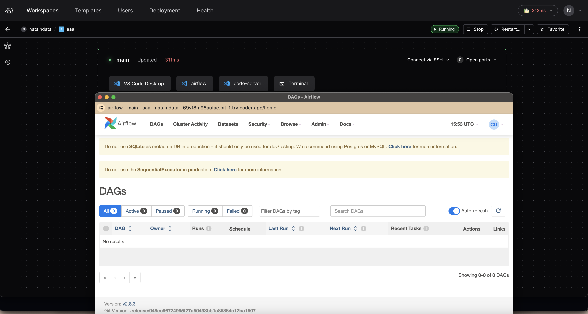

# airflow

A module that adds Apache Airflow in your Coder template.

```tf
module "airflow" {
  count    = data.coder_workspace.me.start_count
  source   = "registry.coder.com/nataindata/apache-airflow/coder"
  version  = "2.0.0"
  agent_id = coder_agent.main.id
}
```

## Installation and compatibility

The workspace image must provide Bash, `python3`, and either `uv` or `pipx` on
`PATH` (or in `~/.local/bin`). With `pipx`, install the Python venv package too;
on Ubuntu 24.04, these prerequisites are available as `python3-venv` and `pipx`.
The module does not install system packages or require sudo.

Airflow is installed in an isolated tool environment, so Ubuntu 24.04's
externally managed system Python is left untouched. `uv` is preferred; `pipx`
is used only when `uv` is absent. An installation failure stops that script and
is reported in the install log, without retrying with another installer.

The default is Airflow 2.11.0 with the release's official dependency constraints
for the workspace's `python3` version (Python 3.12 on Ubuntu 24.04). Set
`airflow_version` to an exact compatible Airflow 2.7 or later 2.x release when needed. Airflow 3
is not supported by this module's webserver and user-management commands.
Installation requires access to the configured Python package index and the
constraints files on `raw.githubusercontent.com`.

The module starts the webserver on the configured port and starts the scheduler.
It migrates the database on startup, preserves existing users, and creates the
initial `admin` account with password `admin` only when it is absent. Change this
development password before sharing the app. Airflow data stays in `AIRFLOW_HOME`
(or Airflow's default `~/airflow`).

## Upgrading from 1.x

Version 2.0.0 requires Coder provider 2.13 or later and a workspace Coder CLI
supporting `coder exp sync`. Installation and startup now use `coder-utils`.
The default Airflow version is pinned to 2.11.0 instead of upgrading to the latest
release on every start; review Airflow's upgrade guidance before changing it.

Module scripts and logs now live under
`~/.coder-modules/nataindata/apache-airflow/`. Check `logs/install.log` and
`logs/start.log` for setup errors, `logs/webserver.log` for the webserver, and
`logs/scheduler.log` for the scheduler. The old default log paths in `/tmp` are
no longer used. An explicitly supplied `log_path` still controls the webserver
log; spaces and quotes are supported, and a leading literal `$HOME` is expanded.


